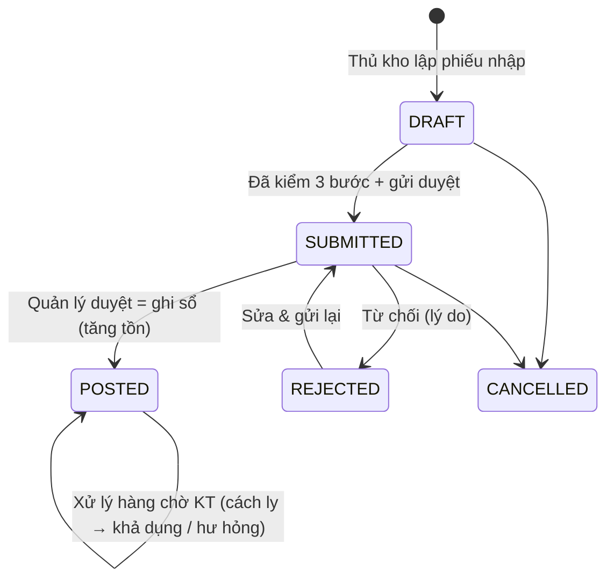
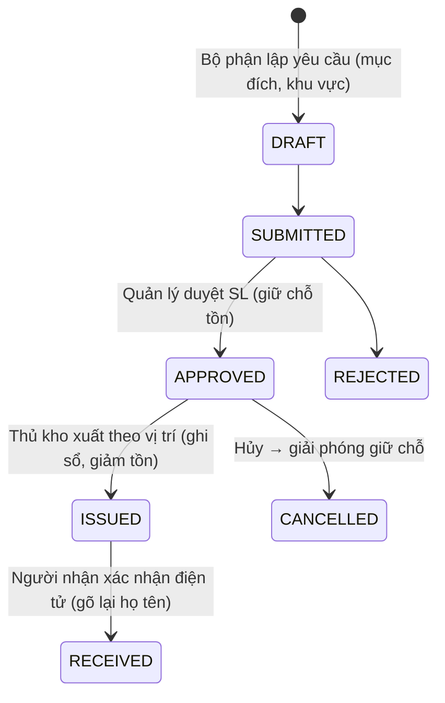

# 01 – Phân tích nghiệp vụ & thiết kế (Giai đoạn 1)

## 1. Phạm vi đã triển khai (v1.1)
Giai đoạn 1–6: nền tảng, phân quyền, **Kho mỏ**, **Kho hóa chất** (phân hệ riêng, theo lô), **Mua hàng & Nhà cung cấp**, 26 báo cáo, import Excel, sao lưu/khôi phục, nhật ký, hướng dẫn vận hành. Ba phân hệ dùng chung người dùng, NCC, bộ phận, đính kèm, nhật ký, báo cáo, nhưng **tách biệt quy trình và dữ liệu nghiệp vụ**: kho hóa chất có bảng lô, sổ cái lô, chứng từ và kho (type CHEMICAL) riêng – không dùng chung chứng từ/tồn của kho vật tư.

### Nguyên tắc riêng của kho hóa chất
- Tồn kho luôn theo **lô**; mỗi dòng nhập tạo một lô có mã nội bộ duy nhất – không gộp lô khác HSD.
- Nhập kho: 5 bước kiểm tra tiếp nhận bắt buộc + chính sách cấu hình (mã lô, HSD, NSX, SDS hiệu lực, thông tin an toàn đã xác nhận). Hóa chất đã hết hạn không được nhập "Đạt".
- Kết quả dòng: Đạt (lô được xuất) / Cách ly (lô bị chặn) / Không đạt yêu cầu (không nhập). Từ chối tiếp nhận toàn bộ.
- Xuất: chặn lô hết hạn, cách ly, không đạt, chưa kiểm tra, hóa chất thiếu/quá hạn SDS; FEFO bắt buộc (cấu hình); hóa chất kiểm soát đặc biệt phải có HSE xác nhận trên từng phiếu; **không có nút bỏ qua cảnh báo an toàn**.
- Thông tin an toàn chỉ do người dùng nhập theo SDS; sửa trường an toàn → hủy xác nhận, HSE xác nhận lại. Cảnh báo lưu trữ không tương thích chỉ dựa trên quy tắc đã được chuyên gia xác nhận; hệ thống không tự đề xuất ghép nhóm hay quy trình xử lý sự cố.

### Mua hàng
Đề nghị mua (gợi ý từ tồn thấp, không tự đặt hàng) → duyệt → yêu cầu báo giá nhiều NCC → so sánh → PO (từ báo giá hoặc trực tiếp) → duyệt (người khác) → gửi NCC → phiếu nhập kho mỏ/hóa chất liên kết dòng PO (chặn nhận vượt SL đặt, sai NCC, sai mặt hàng) → PO tự chuyển Giao một phần / Đã giao đủ → đóng đơn. Số báo giá tối thiểu trước khi lập PO là tham số cấu hình (mặc định 0 – chờ công ty xác nhận).

## 2. Vai trò & nguyên tắc kiểm soát
9 vai trò mặc định (Super Admin, Warehouse Manager, Warehouse Officer, Procurement Officer, Department User, Chemical Store Officer, HSE Officer, Accountant, Director) – quyền chi tiết có thể chỉnh trong màn hình Phân quyền (52 quyền, nhóm theo chức năng: xem / tạo / sửa / hủy / duyệt / xuất báo cáo / xem giá trị / dữ liệu nhạy cảm).

Nguyên tắc được kiểm tra **ở Backend** (không chỉ ẩn nút trên giao diện):
- Người lập/người yêu cầu không được tự phê duyệt (4 mắt).
- Tồn kho chỉ thay đổi khi chứng từ được ghi sổ hợp lệ, trong cùng một transaction.
- Không xuất âm kho; không xuất phiếu chưa duyệt; SL đã duyệt được **giữ chỗ**.
- Chứng từ đã ghi sổ không được sửa/xóa/hủy (chặn cả ở trigger CSDL); sai sót xử lý bằng phiếu điều chỉnh có lý do + người duyệt.
- Người dùng bộ phận chỉ xem chứng từ của bộ phận mình.
- Khóa kỳ kho: chặn ghi sổ chứng từ có ngày chứng từ ≤ ngày khóa.

## 3. Quy trình nghiệp vụ

Kiểm kê: `DRAFT → (Chốt tồn sổ) COUNTING → (Gửi duyệt: lập phiếu điều chỉnh chênh lệch, chưa ghi sổ) SUBMITTED → (Duyệt) POSTED` · trả về `COUNTING` nếu từ chối.
Hàng trả lại: `DRAFT → SUBMITTED → INSPECTED (phân loại dùng được / hư hỏng / chờ xử lý) → POSTED`.
Điều chuyển & điều chỉnh: `DRAFT → SUBMITTED → POSTED`.

**Ghi chú thiết kế phiếu xuất:** tồn kho giảm tại bước *Xuất kho* (hàng thực tế rời kho), người nhận xác nhận sau đó. Nếu ghi sổ sau xác nhận thì tồn trên hệ thống sẽ lớn hơn tồn thực trong khoảng thời gian chờ – sai lệch kiểm soát.

## 4. Thiết kế tồn kho
- **Sổ cái `stock_movements`** bất biến là nguồn sự thật; **`inventory_balances`** là số dư theo (kho, vị trí, mặt hàng) với 3 loại tồn: *khả dụng*, *chờ kiểm tra* (cách ly), *hư hỏng*. Có chức năng **đối chiếu** số dư với sổ cái.
- Ghi sổ nguyên tử: khóa advisory theo (kho, mặt hàng) theo thứ tự → hai người thao tác đồng thời được tuần tự hóa; `UPDATE … WHERE tồn >= SL` + CHECK constraint → không thể âm kho.
- Chuyển trạng thái chứng từ có điều kiện (`WHERE status = …`) → bấm duyệt 2 lần/2 người chỉ ghi sổ 1 lần.
- `client_request_id` chống tạo trùng chứng từ khi bấm lưu nhiều lần.
- Phân biệt 3 loại ngày: ngày chứng từ (`doc_date`), ngày giao nhận thực tế (`received_date`/`issued_at`/`handover_at`), ngày ghi sổ (`posted_at`). Báo cáo kỳ & tồn tại thời điểm tính theo ngày ghi sổ.
- Trạng thái tồn: Hết hàng (≤0) · Dưới tối thiểu · Vượt tối đa · Sắp hết (≤ max(tối thiểu × hệ số cấu hình, tồn an toàn)) · Còn hàng; cờ riêng "Đang chờ kiểm tra".

## 5. Về yêu cầu "cơ sở dữ liệu trên Cloudflare"
Đề bài vừa yêu cầu PostgreSQL + Prisma + transaction nguyên tử, vừa nêu "dùng cơ sở dữ liệu trên Cloudflare". Cloudflare **không cung cấp PostgreSQL**; CSDL của Cloudflare là **D1 (SQLite)** – không hỗ trợ transaction tương tác, khóa hàng/khóa advisory, trigger kiểu PostgreSQL mà bộ máy ghi sổ cần để đảm bảo không sai lệch tồn khi thao tác đồng thời. Vì quy tắc "không tự ý thay đổi công nghệ" và yêu cầu toàn vẹn dữ liệu, hệ thống giữ **PostgreSQL**, và dùng Cloudflare ở các vai trò phù hợp:
1. **Cloudflare Tunnel** (+ Cloudflare Access nếu muốn): đưa hệ thống chạy trên máy chủ nội bộ ra Internet qua HTTPS mà không mở cổng router (cấu hình sẵn trong `deploy/`).
2. **Cloudflare R2**: lưu bản sao lưu ngoài site (`deploy/backup.sh` hỗ trợ rclone → R2).
3. Nếu công ty muốn CSDL "trên mây": dùng PostgreSQL được quản lý (Neon / Supabase / RDS…) – chỉ đổi `DATABASE_URL`, có thể kết hợp **Cloudflare Hyperdrive** khi về sau chạy API trên Cloudflare Workers.
→ **Cần công ty xác nhận** phương án hạ tầng (mục 6).

## 6. Các điểm CẦN CÔNG TY XÁC NHẬN (không tự giả định)
| # | Nội dung | Hiện trạng trong hệ thống |
|---|---|---|
| 1 | Phương án hạ tầng: máy chủ nội bộ + Cloudflare Tunnel / VPS / PostgreSQL đám mây | Hỗ trợ cả 3, mặc định máy chủ nội bộ |
| 2 | Phương pháp tính giá xuất kho (FIFO / bình quân gia quyền / khác) | Cấu hình `Chưa xác nhận`; đơn giá được lưu ở phiếu nhập; giá trị tồn hiển thị "chưa cấu hình" |
| 3 | Đồng tiền hạch toán chính, danh sách tiền tệ, nguồn tỷ giá | Lưu tiền tệ + tỷ giá theo phiếu; đồng tiền chính để trống |
| 4 | Ma trận phê duyệt: ai duyệt phiếu nhập/xuất/điều chỉnh theo giá trị/bộ phận; có duyệt 2 cấp không | Mặc định Warehouse Manager duyệt; quyền có thể cấp cho vai trò khác |
| 5 | Định mức cấp phát theo bộ phận/tháng | Hiện có định mức theo mặt hàng/phiếu (cảnh báo + bắt buộc lý do) |
| 6 | Hệ thống mã vật tư hiện tại (cấu trúc mã), danh mục nhóm/phân nhóm chuẩn | Seed 9 nhóm theo phạm vi 5.1, sửa được |
| 7 | Có cho phép ghi sổ khi đang kiểm kê không (đóng băng khu vực) | Cho phép, nhưng cảnh báo số giao dịch phát sinh sau chốt sổ |
| 8 | Chính sách hóa chất: thông tin bắt buộc khi nhập, danh mục kiểm soát đặc biệt, quy tắc tương thích lưu trữ, mốc cảnh báo HSD | Đã có cấu hình (mặc định: bắt buộc lô, HSD, SDS; FEFO; 30/60/90 ngày) – công ty xác nhận/điều chỉnh tại Cấu hình |
| 9 | Quy trình mua hàng & phê duyệt tài chính: ngưỡng giá trị theo cấp duyệt, số báo giá tối thiểu, tiêu chí & trọng số đánh giá NCC | Hiện: 1 cấp duyệt PR, 1 cấp duyệt PO (Director), trọng số đánh giá 35/30/20/15 – cần công ty xác nhận |
| 10 | Thời gian lưu giữ nhật ký, số bản sao lưu, nơi lưu ngoài site | Mặc định giữ 30 bản tự động, nhật ký lưu vĩnh viễn |

## 7. Những điều chỉnh so với danh sách bảng gợi ý (có lý do)
Xem `02-database.md` mục "Bổ sung/điều chỉnh".
